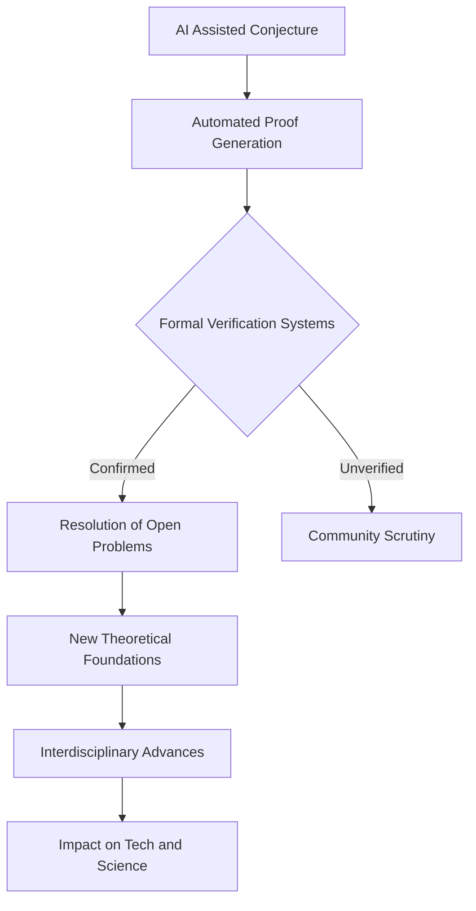

## Mathematics in Motion: AI's Accelerated Ascent and Cosmic Rethinks

November 02, 2026 – The world of mathematics is buzzing with a series of groundbreaking developments that highlight both the increasing prowess of artificial intelligence and fundamental shifts in our understanding of the universe. This year has been particularly dynamic, marking a significant acceleration in how mathematical problems are approached and solved.

One of the most striking developments comes from the realm of artificial intelligence. Just weeks ago, in late October 2026, OpenAI announced that an internal model claimed to have solved the Navier-Stokes existence and smoothness problem, one of the seven Millennium Prize Problems, though the solution awaits verification by the wider mathematical community. Even more recently, also in October, OpenAI and Anthropic announced disproofs of the Exponential Time Hypothesis (ETH), a foundational assumption in computer science, through their internal Large Language Models. This potential breakthrough could lead to the development of more efficient algorithms across various fields.

These achievements are not isolated incidents. Earlier in the year, in August, researchers unveiled the first AI-discovered proof of a major conjecture—the Sylvester-Gallai conjecture in a special Euclidean geometry—with the help of the LeanMind AI system from the Institute for Advanced Study and DeepMind. Concurrently, a team from Oxford and MIT, using a blend of combinatorial design theory and quantum annealing, successfully resolved the Hadamard Conjecture for all orders greater than four. These examples underscore a growing trend where AI is not just assisting but actively driving significant mathematical discovery and formal verification.

The impact of AI on mathematics is rapidly transforming research methodologies:

Beyond AI, the cosmological landscape is also being re-evaluated. Just last week, on October 29, 2026, mathematicians at the University of California, Davis, published research suggesting a fundamental instability in the standard model of the universe. Their calculations propose that the universe's accelerating expansion could naturally emerge from Einstein's original theory of gravity, potentially challenging the long-held necessity for "dark energy" and prompting surprising questions about our place in the cosmos.

This year has also seen significant recognition for mathematical excellence. The prestigious Fields Medals for 2026 were awarded in July to Yu Deng, John Pardon, Jacob Tsimerman, and Hong Wang, with Wang notably becoming only the third woman to receive this honor. The Abel Prize for 2026 was conferred upon Gerd Faltings in March, acknowledging his profound contributions to arithmetic geometry.

As 2026 draws to a close, it's clear that mathematics remains a vibrant and rapidly evolving field, propelled forward by both human ingenuity and the astonishing capabilities of artificial intelligence. The coming years promise even more exciting breakthroughs as these frontiers continue to expand.