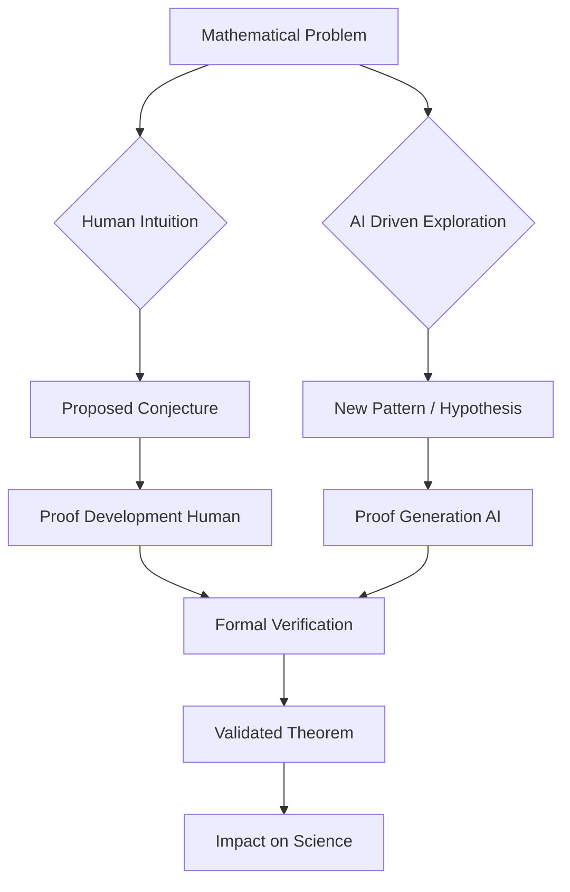

## Mathematics in Motion: Fields Medals and the AI Frontier Define a Landmark Year

November 3, 2026, finds the world of mathematics buzzing with excitement, reflecting on a year of profound breakthroughs and paradigm shifts. From the prestigious recognition of groundbreaking human intellect to the accelerating impact of artificial intelligence, 2026 has undeniably been a landmark year for the discipline.

A highlight of the year was the awarding of the **Fields Medals** in July 2026 at the International Congress of Mathematicians in Philadelphia. These "Nobel Prizes of mathematics" recognized four brilliant minds under the age of 40: Yu Deng of the University of Chicago, John Pardon of Stony Brook University, Jacob Tsimerman of the University of Toronto, and Hong Wang of New York University and France's Institut des Hautes Études Scientifiques. Notably, Hong Wang made history as only the third woman ever to receive the medal in its 90-year history, honored for her significant contributions to harmonic analysis and geometric measure theory, including advances on the Kakeya conjecture.

Beyond individual accolades, 2026 has seen the rapid integration and impact of artificial intelligence in mathematical research. AI systems are no longer merely tools for computation; they are actively participating in discovery and verification. This year, we witnessed the first AI-discovered proof of a major conjecture, the Sylvester-Gallai conjecture in a special Euclidean geometry, achieved by an AI system named LeanMind. Another significant leap involved the resolution of the Hadamard Conjecture for all orders greater than 4, combining combinatorial design theory with quantum annealing.

The formalization of mathematics is also reaching a tipping point, with top mathematics journals reportedly requiring formal verification for computationally intensive proofs. This trend underscores a massive collaborative effort, like the Formal Math Project, which has formalized over 500,000 theorems. Even more recently, in October 2026, OpenAI announced new discoveries, including one related to local smoothing and the Kakeya conjecture (the same area as Fields medalist Hong Wang's work), a disproof of the Exponential Time Hypothesis, and a rigorous existence proof of certain quantum field theories.

The interplay between human intuition and machine intelligence is reshaping how mathematical problems are approached, solved, and verified. As 2026 draws to a close, it's clear that this evolving collaboration promises an even more dynamic future for mathematics.

