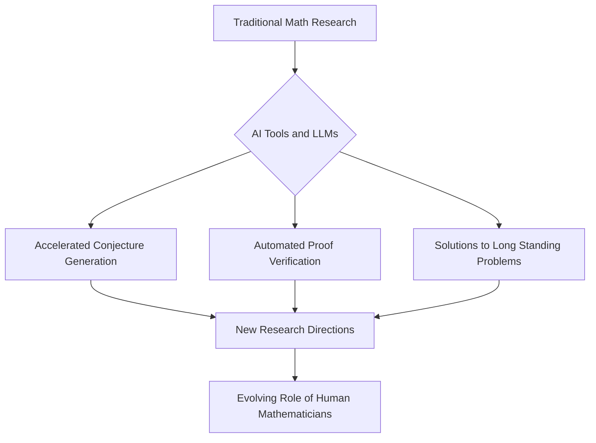

Mathematics continues to be a vibrant and rapidly evolving field, with late 2025 and 2026 marking a period of significant breakthroughs and transformative changes, especially concerning the role of artificial intelligence.

### Fields Medals 2026 Celebrate Groundbreaking Work

The mathematical community recently celebrated the awarding of the prestigious Fields Medals for 2026, often regarded as the "Nobel Prize of mathematics." Four brilliant minds were recognized for their outstanding achievements. Yu Deng was honored for his profound work in partial differential equations, including the rigorous derivation of the Boltzmann equation from hard-sphere dynamics, a contribution connected to a major case of Hilbert's Sixth Problem. Hong Wang received a medal for her advancements in harmonic analysis and geometric measure theory, notably including the resolution of the three-dimensional Kakeya conjecture. John Pardon and Jacob Tsimerman were also lauded for their exceptional contributions to the field.

### AI Reshapes the Landscape of Mathematical Discovery

Perhaps the most discussed development in mathematics as of late 2026 is the burgeoning and often debated role of artificial intelligence. In October 2026, OpenAI reportedly released a substantial collection of over 700 research papers, some detailing AI-discovered proofs and candidate solutions to high-profile mathematical problems, including claims of solving a Millennium Prize Problem.

This surge in AI-assisted discovery, fueled by tools like the "Lean Conjecturer" and advanced large language models, is fundamentally altering how mathematicians approach research. While some express concerns about the implications for human mathematicians and the very nature of proof, others view AI as an unprecedented tool to accelerate discovery, tackle previously intractable problems, and open entirely new avenues of inquiry. The integration of AI into formal verification tools is also gaining traction, with some top mathematics journals reportedly beginning to require formalization for proofs relying on heavy computation.

Beyond these highlights, the past year has also seen the resolution of several other long-standing conjectures, such as the Moving Sofa Problem and a significant advancement in the Twin Prime Conjecture (conditional on the Generalized Riemann Hypothesis). The ongoing dialogue surrounding AI's role and these significant intellectual milestones underscore a dynamic and exciting era for mathematics.

