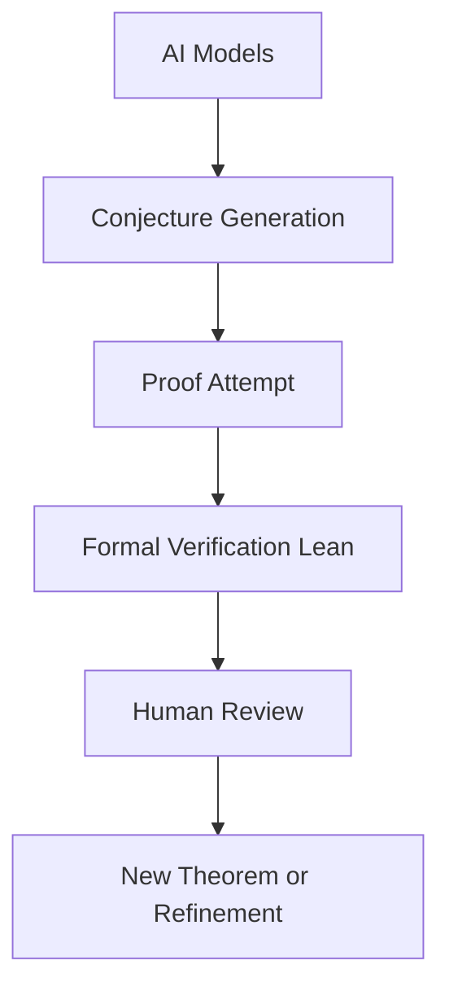

## Mathematics in the Machine Age: AI Transforms Discovery and Proof

**November 07, 2026** – The world of mathematics is experiencing an unprecedented revolution, driven by the rapid advancements in artificial intelligence. What was once the exclusive domain of human intuition and rigorous mental effort is now being profoundly reshaped by AI, with machines generating conjectures and even providing proofs at a scale and speed previously unimaginable.

Recent months have seen an explosion of AI-driven mathematical output. In October 2026, OpenAI made headlines by releasing an astonishing 722 mathematical manuscripts, all generated by an unreleased internal AI model. These manuscripts spanned diverse areas such as algebra, number theory, and topology, tackling problems that have long challenged human mathematicians. This followed earlier breakthroughs in May and August, including a claimed disproof of the unit distance problem and significant progress on Millennium Prize Problems like Navier-Stokes.

This surge in AI-generated mathematics is not merely about solving textbook problems; AI is now actively contributing key insights that aid human researchers in tackling decades-old conjectures. While AI models are capable of generating complex mathematical arguments, human mathematicians remain crucial for interpreting, verifying, and refining these outputs. Many of these AI-generated proofs are accompanied by machine-readable formalizations using tools like Lean, which automate a significant portion of the verification process, though human judgment is still the ultimate arbiter of meaning and correctness.

The sheer volume and speed of AI's mathematical output have "sent the world of mathematics reeling," prompting widespread discussion about the future of discovery and achievement in the field. This pivotal moment highlights a new paradigm where human and artificial intelligence collaborate to push the boundaries of mathematical knowledge.

The process often looks something like this:

As a leading expert recently emphasized, the relationship between mathematics and AI is foundational, with mathematical principles underpinning every major advancement in artificial intelligence. This symbiotic relationship promises a future where mathematics itself is accelerated by the very technology it helps create.