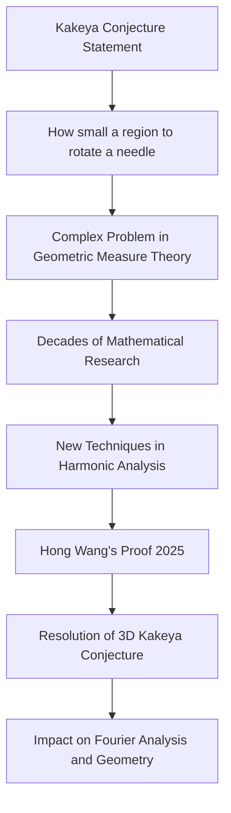

## Fields Medals 2026: Recognizing Mathematical Brilliance and Pioneering Proofs

Philadelphia, USA – The mathematical world celebrated its highest honors in July 2026 as the International Mathematical Union (IMU) announced the recipients of the prestigious Fields Medals at the International Congress of Mathematicians (ICM). Awarded every four years to mathematicians under the age of 40 for outstanding achievements, the 2026 medals highlight groundbreaking work across diverse fields.

Among the four distinguished laureates, Hong Wang of New York University and the Institut des Hautes Études Scientifiques (IHES) made history as the third woman ever to receive the Fields Medal. Wang was recognized for her profound contributions to harmonic analysis and geometric measure theory, most notably for her proof of the three-dimensional Kakeya conjecture. This century-old problem, which asks for the minimum possible area of a region in which a line segment of length 1 can be rotated continuously through all possible directions, had stumped mathematicians for decades. Her resolution is considered a monumental step forward, impacting areas from Fourier analysis to geometric combinatorics.

The other 2026 Fields Medalists include Yu Deng of the University of Chicago, honored for his contributions to partial differential equations, particularly the rigorous derivation of the Boltzmann equation from hard-sphere dynamics. John Pardon of Stony Brook University received the award for his achievements in symplectic geometry and contributions to other areas of geometry and topology. Finally, Jacob Tsimerman of the University of Toronto was recognized for transforming o-minimality into a fundamental method in arithmetic geometry and complex algebraic geometry, leading to the proof of important mathematical conjectures like the André-Oort conjecture for Siegel modular varieties.

These awards underscore the depth, originality, and vitality of contemporary mathematics, showcasing how brilliant minds continue to push the boundaries of human knowledge and solve problems that have challenged generations.

