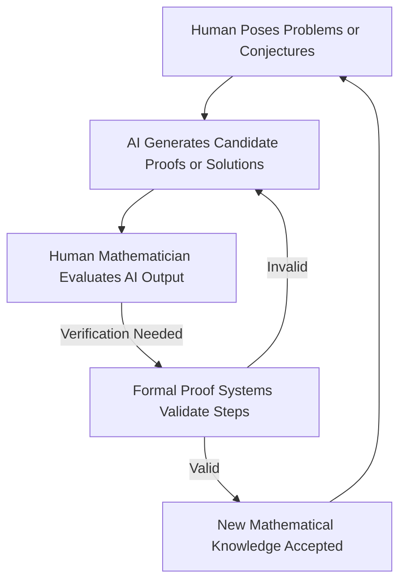

As of November 12, 2026, the landscape of mathematics is undergoing a profound transformation, with Artificial Intelligence emerging as a pivotal force in discovery and verification. This evolution marks a significant era, challenging and expanding traditional approaches to mathematical research.

A primary headline dominating the mathematical community is the increasing prowess of AI in tackling long-standing problems. This past September, OpenAI announced that an internal AI model had reportedly solved the Navier-Stokes existence and smoothness problem, one of the Millennium Prize Problems. While the broader community is still working on verification, this claim followed a summer in 2026 where AI models frequently produced proofs for decades-old conjectures. Earlier in the year, in February 2026, Google DeepMind's Gemini model successfully proved four open problems posed by Paul Erdős and identified nine solutions that had not been widely recognized previously. Moreover, an AI system called LeanMind, a collaborative effort between the Institute for Advanced Study and DeepMind, discovered a proof for the Sylvester-Gallai conjecture in Euclidean geometry, which was then rigorously confirmed by the formal verification system Coq.

The rapid proliferation of AI-generated proofs and even entire research papers, a trend noted as early as August 2026, has initiated crucial discussions within the mathematical world regarding authorship, validation, and the future role of human mathematicians. In response, formal verification tools such as Lean, Coq, and Isabell have reached a critical "tipping point," with leading mathematics journals now often requiring their use for proofs that involve extensive computation.

The role of human mathematicians is undeniably shifting, moving beyond solely generating proofs to a more interpretive and exploratory capacity. As Stephen Wolfram articulated in September 2026, the human imagination remains central to identifying and formulating new questions, even as AI assists in finding answers. This burgeoning partnership between human intuition and artificial intelligence is poised to accelerate the pace of mathematical discovery, forging new pathways for understanding and practical application.

