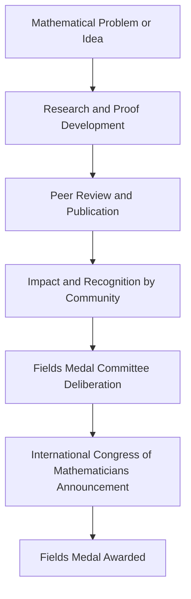

## Mathematics in the Limelight: The 2026 Fields Medalists Chart New Frontiers

As of November 14, 2026, the global mathematical community is still buzzing with the monumental announcements made at the International Congress of Mathematicians (ICM) in Philadelphia this past July. The prestigious Fields Medals, often considered the "Nobel Prize of Mathematics," were awarded to four exceptional minds under the age of 40, recognizing their profound contributions and the promise of future breakthroughs.

The 2026 Fields Medal recipients are:

*   **Yu Deng (University of Chicago, USA)**: Recognized for his groundbreaking work in partial differential equations. Deng made significant strides in solving a part of David Hilbert's Sixth Problem, establishing a strong theoretical connection between the microscopic world of particles and the macroscopic behavior of fluids. His research strengthens the foundations of kinetic theory and fluid dynamics, bridging mathematics and physics.
*   **John Pardon (Stony Brook University, USA)**: Honored for his achievements in symplectic geometry and topology. His contributions include innovative approaches to virtual fundamental cycles and the counting of holomorphic curves. Pardon also resolved the 20-year-old MNOP conjecture.
*   **Hong Wang (New York University, USA / IHÉS, France)**: Awarded for her pivotal work in harmonic analysis and geometric measure theory. Wang notably solved the three-dimensional Kakeya Conjecture, a major problem that remained open for nearly 50 years. Her research has wide-ranging applications in areas such as signal processing and wave analysis. She also made history as the third woman to receive the Fields Medal.
*   **Jacob Tsimerman (University of Toronto, Canada)**: Recognized for transforming o-minimality into a fundamental method within arithmetic geometry and complex algebraic geometry. His work was instrumental in proving important mathematical conjectures, including Griffiths's conjecture on the algebraicity of the images of period maps and the André–Oort conjecture for Siegel modular varieties.

These mathematicians exemplify the vibrant and interconnected nature of modern mathematical research, pushing the boundaries of human understanding with their ingenuity and dedication. Their achievements, announced on July 23, 2026, continue to inspire new avenues of inquiry and collaboration across the mathematical sciences.

