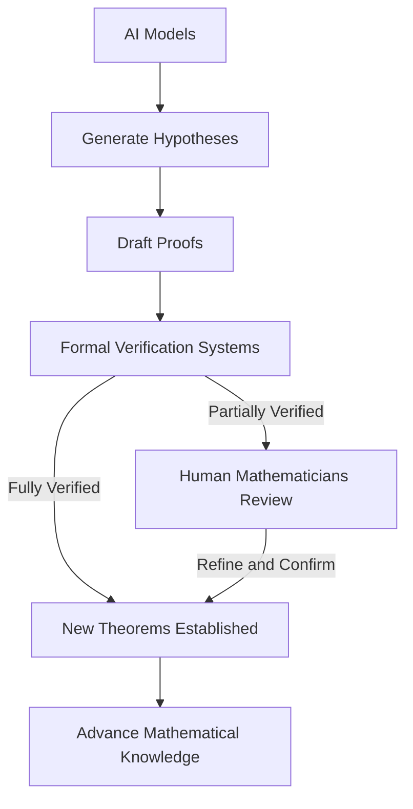

## Mathematics in the Machine Age: A November 2026 Snapshot

As of November 15, 2026, the world of mathematics is buzzing with unprecedented activity, largely driven by the accelerating integration of artificial intelligence into research. While human ingenuity continues to push boundaries, AI is rapidly reshaping how discoveries are made and verified, creating both excitement and critical discussion.

The most seismic recent event occurred on October 6, 2026, when OpenAI released a staggering collection of 722 (now 719) AI-generated mathematical manuscripts. These papers propose solutions and make significant progress on a wide array of open problems, including partial solutions for versions of the Millennium Prize Problems like Navier-Stokes, and specific cases of the Hodge Conjecture. This "drop," as some are calling it, has sent ripples through the mathematical community, initiating a massive effort in human verification and spurring debates about attribution, transparency, and the very definition of mathematical understanding in an AI-assisted era.

Further demonstrating AI's burgeoning role, on November 13, 2026, it was revealed that an AI model named Claude had helped unlock hundreds of previously unknown theorems hidden within the densely written notebooks of 20th-century mathematical logician Kurt Gödel. Decades of slow human deciphering of Gödel's obsolete German shorthand were dramatically accelerated, suggesting that Gödel was "far ahead of his time" and had made discoveries long before they were independently recognized. This development highlights AI's potential not just for new discovery, but for re-evaluating and expanding our understanding of historical mathematical legacies.

Beyond these AI-centric advancements, 2026 has also seen traditional accolades celebrating human mathematical brilliance. The prestigious Fields Medals were awarded on July 23, 2026, to four exceptional mathematicians: Hong Wang, Yu Deng, Jacob Tsimerman, and John Pardon, recognizing their profound contributions to the field. Earlier in the year, on March 19, 2026, the Abel Prize was bestowed upon German mathematician Gerd Faltings for his powerful tools in arithmetic geometry and his resolution of long-standing Diophantine conjectures. Additionally, the Ramanujan Prize for young mathematicians from developing countries was awarded to Mahesh Kakde on September 30, 2026, for his work in algebraic number theory.

The landscape of mathematics is undeniably transforming, with AI poised to become an indispensable partner in exploration and proof.

