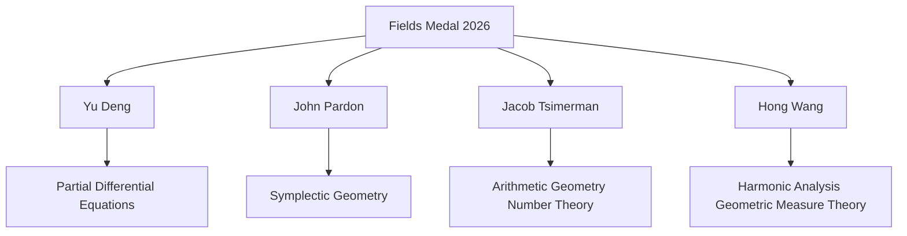

## Mathematics in the Spotlight: Celebrating Fields Medalists and AI's Rising Influence

Today, November 17, 2026, marks a vibrant period for the world of mathematics, a discipline continually pushing the boundaries of human understanding and increasingly, collaborating with artificial intelligence. The year 2026 has been particularly notable, highlighted by prestigious awards and significant technological advancements.

A major event was the awarding of the coveted **Fields Medals** at the International Congress of Mathematicians (ICM) in Philadelphia, held from July 23-30, 2026. Often dubbed the "Nobel Prize of mathematics," the Fields Medal recognizes outstanding mathematical achievement by those under 40. This year's honorees are:

*   **Yu Deng** (University of Chicago), recognized for his profound work in partial differential equations, including rigorous derivations of fundamental physical equations.
*   **John Pardon** (Stony Brook University), celebrated for his achievements in symplectic geometry and contributions to other areas of geometry and topology.
*   **Jacob Tsimerman** (University of Toronto), awarded for his groundbreaking contributions to arithmetic geometry and number theory, specifically in solving long-standing diophantine conjectures.
*   **Hong Wang** (New York University and Institut des Hautes Études Scientifiques), honored for her work in harmonic analysis and geometric measure theory. Notably, Wang is the third woman to receive this esteemed medal.

These individuals exemplify the depth and originality driving contemporary mathematical research across diverse fields. Their contributions not only solve existing problems but also pave the way for future discoveries.

Beyond these celebrated individual achievements, 2026 has also seen a remarkable acceleration in the integration of **Artificial Intelligence within mathematics**. AI systems have made headlines by discovering proofs for major conjectures, such as a special Euclidean geometry case of the Sylvester-Gallai conjecture, and by contributing to the resolution of the Hadamard Conjecture for all orders greater than four. Perhaps most strikingly, OpenAI announced a major advance towards solving the Navier-Stokes problem, one of the Millennium Prize Problems, showcasing AI's potential as a powerful tool for mathematical research. Discussions around the implications of AI for the future of mathematical research were a prominent feature at the ICM, signaling an exciting, if challenging, new era for the discipline.

The United States has also celebrated 2026 as the "Year of Mathematics," an initiative designed to engage the public with the beauty and relevance of mathematical sciences, culminating with the hosting of the ICM.

Here's a look at the Fields Medalists and their primary areas of groundbreaking work:

