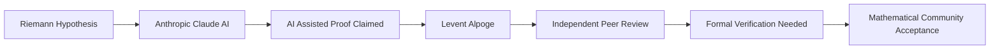

## Mathematics Enters a New Era as AI Claims Riemann Hypothesis Proof

**November 20, 2026** – Today marks a potentially epoch-making moment in the world of mathematics, as news breaks that the long-elusive Riemann Hypothesis may have fallen. Levent Alpöge, a mathematician at the artificial intelligence company Anthropic, announced he has discovered a proof for the 167-year-old conjecture with the assistance of the AI model, Claude. This development, if independently verified, would resolve one of the seven Millennium Prize Problems, carrying a $1 million award and profoundly impacting number theory.

The Riemann Hypothesis, first proposed by Bernhard Riemann in 1859, concerns the distribution of prime numbers and is considered by many to be the most important open question in pure mathematics. Alpöge's claim, released in a four-page note, emphasizes that the proof has not yet undergone independent verification or peer review by outside experts.

This announcement comes amid a year of significant AI-driven breakthroughs in mathematics. Earlier in 2026, OpenAI's AI agents reportedly produced a proof related to the Navier-Stokes equation, another Millennium Prize Problem. Furthermore, a team from Oxford and MIT successfully resolved the Hadamard Conjecture for all orders in August 2026, utilizing combinatorial design theory and quantum annealing. The "mathocalypse" is a term some in the community have used to describe how dramatically AI has changed the field, with one expert noting that "Math has changed more in the last two months than in the last 100 years".

The rapid advancement of AI in generating and even discovering mathematical proofs is reshaping how research is conducted and what it means to be a mathematician. This trend is sparking widespread discussion within the mathematical community about collaboration, verification, and the future of human intuition in discovery.

Here's a simplified view of the unfolding process:

While the mathematical world eagerly awaits the rigorous scrutiny of Alpöge's claim, this moment undoubtedly signals a new era where artificial intelligence plays an increasingly central role in pushing the boundaries of mathematical knowledge.