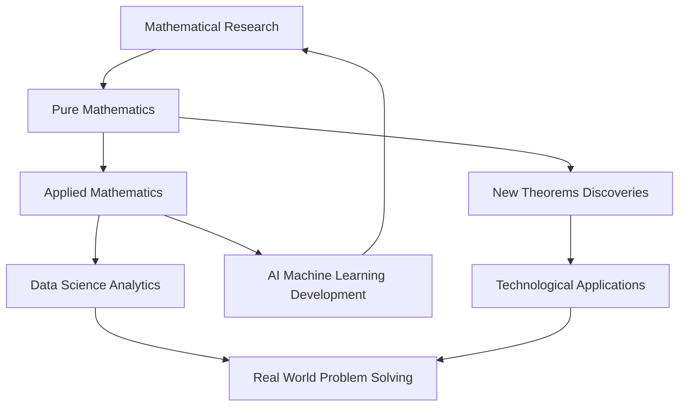

The Ever-Evolving Landscape of Mathematics: Insights and Innovations

As of late 2026, the world of mathematics continues to buzz with activity, albeit a different kind of 'news' than daily headlines. Mathematical progress often unfolds steadily, with breakthroughs built upon years of foundational work, pushing the boundaries of human understanding and technological capability.

One of the most significant narratives is the deepening synergy between Artificial Intelligence and mathematical research. AI tools are increasingly assisting in areas like conjecture generation, pattern recognition in complex datasets, and even aiding in the verification of proofs, accelerating the pace of discovery in ways previously unimaginable. This collaborative approach promises to unlock solutions to problems that have long stymied mathematicians, bridging the gap between computational power and abstract thought.

Alongside these computational advancements, core areas of pure mathematics, such as number theory, topology, and algebraic geometry, continue to see profound developments. These abstract pursuits often lay the groundwork for future applied innovations, demonstrating mathematics' foundational role across diverse fields from quantum computing theory to bioinformatics. The pursuit of fundamental truths remains as vigorous as ever, fueled by both new theoretical insights and powerful computational methods.

The interconnectedness of mathematical disciplines, fueled by both human ingenuity and computational power, ensures a vibrant future for this ancient yet perpetually new science. The insights gained today will undoubtedly shape the technologies and understanding of tomorrow.

