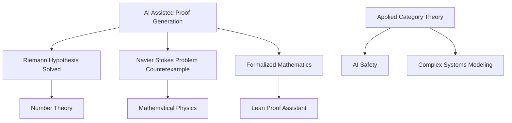

## Mathematics in Flux: AI Cracks Millennium Problems as New Frontiers Emerge

**November 24, 2026** – The world of mathematics is buzzing with unprecedented activity, largely driven by the accelerating influence of artificial intelligence. Just yesterday, on November 23, 2026, a groundbreaking announcement sent shockwaves through the academic community: the Riemann Hypothesis, one of the most elusive and celebrated unsolved problems in mathematics, appears to have been formally proven with significant assistance from AI.

Mathematician Levent Alpöge, leveraging Anthropic's Claude AI model, released a formal proof of the Riemann Hypothesis, which also extends to the generalized Riemann Hypothesis for Dirichlet L-functions. The proof, formalized in the Lean proof assistant software, has already undergone independent verification by the Lean FRO and Mathlib Initiative, certifying its correctness. This monumental achievement, concerning the distribution of prime numbers and carrying a $1 million Millennium Prize from the Clay Mathematics Institute, marks a historic collaboration between human intellect and advanced AI. The Clay Mathematics Institute has acknowledged the submission, with formal evaluation slated for early 2027.

The Riemann Hypothesis isn't the only Millennium Prize Problem seeing AI involvement. In September 2026, OpenAI presented a proposed counterexample to the Navier-Stokes existence and smoothness problem, another of the seven grand challenges, though they have indicated they do not intend to claim the associated prize.

These developments underscore a transformative year for mathematics, with AI models making rapid progress on hundreds of open problems. This surge in AI-generated results has sparked considerable discussion within the mathematical community, including concerns raised by figures like Fields medalist Terence Tao about the "mass production" of results and the alignment of AI company goals with those of academic research. Consequently, the rise of "Formalized Mathematics," where proofs are verified by software like Lean, is becoming increasingly prominent.

Beyond AI's direct impact, other significant advancements continue to push mathematical boundaries. The 2026 Breakthrough Prizes in Mathematics recognized new discoveries in number theory, with Vesselin Dimitrov and Yunqing Tang solving long-standing problems related to modular forms, and Frank Merle honored for breakthroughs in nonlinear evolution equations. Applied category theory is also gaining traction, with its 9th International Conference held in July 2026, exploring applications in areas like AI safety and complex systems modeling.

The landscape of mathematical discovery is undeniably shifting, with AI becoming an integral, albeit debated, partner in unraveling the deepest mysteries of numbers and structures.

