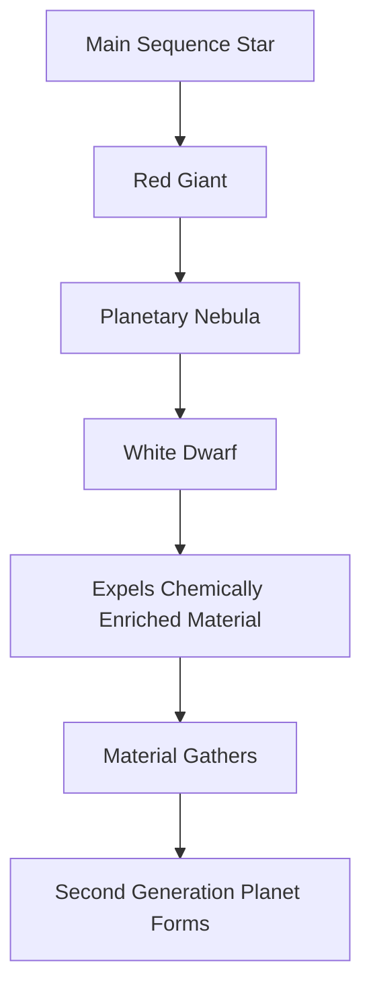

## Cosmic Recycling: A Dead Star May Be Birthing a New World

**October 10, 2026** – In a fascinating twist on stellar evolution, astronomers are revisiting old data from NASA's Hubble Space Telescope and have uncovered evidence suggesting a dead star, a white dwarf, may have given birth to a "second-generation" planet. This discovery, published on October 5th in *Nature Astronomy*, challenges conventional understanding of planetary formation and offers a glimpse into the cosmic potential for rebirth.

The cold case involved the white dwarf HS 0209+0832. White dwarfs are the dense remnants of stars like our Sun after they've exhausted their nuclear fuel and shed their outer layers into space. Scientists propose that after the star expelled this chemically enriched material, a portion of it eventually coalesced, forming a gas giant planet. While most of the remaining material has since dispersed, the suspected planet might still be orbiting the stellar corpse.

This breakthrough suggests that the death of a star doesn't necessarily mean the end of planetary formation in its system. Instead, the dramatic expulsion of material during its red giant phase could act as a fertile ground for new worlds to emerge from the stellar ashes. This ongoing research continues to reshape our understanding of where and how planets can form across the universe.

Here's a simplified look at the proposed process:

