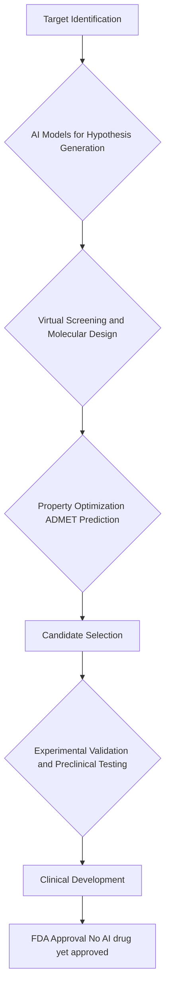

## Science Headlines: Cosmic Mysteries, Life's Blueprint, and AI's Healing Touch

October 13, 2026 – Science continues to push the boundaries of our understanding, with recent breakthroughs shedding light on the universe's earliest moments, the fundamental conditions for life, and the accelerating pace of medical innovation.

**James Webb Telescope Unveils Early Universe Surprises**
NASA's James Webb Space Telescope (JWST) is once again rewriting cosmic history. Just today, it revealed an ancient galaxy cluster, XLSSC 122, with an unexpectedly dense concentration of dark matter, challenging existing theories on how the universe evolved. This cluster, dating back to when such massive structures were just forming, suggests cosmic development might have been much faster than previously thought. Furthermore, the JWST has detected faint intracluster light, the earliest known instance of starlight scattered between galaxies, offering new insights into galaxy cluster formation. Earlier in October, Webb also provided a glimpse into violent planetary collisions around young stars, similar to the one believed to have formed Earth's Moon. Another significant, and unforeseen, discovery by Webb has been a "swarm of crimson specks of light" dubbed "little red dots" in the distant, young universe, thriving from 600 million to 1.5 billion years after the Big Bang before mysteriously disappearing.

**The Universe's Fine-Tuned Constants for Life**
In a profound discovery reported on October 11, 2026, scientists have found that the universe's fundamental physical constants may be incredibly finely balanced to support life. Even minute alterations to these constants could render liquids too thick or too thin for essential biological processes, potentially preventing life as we know it from existing. Remarkably, these life-friendly conditions were present billions of years before the emergence of living cells, raising intriguing questions about the universe's inherent suitability for life.

**AI Revolutionizes Drug Discovery**
Artificial intelligence is rapidly transforming the landscape of drug discovery in 2026, moving from a supplementary tool to a core component of the process. AI is enabling scientists to generate, rank, and refine hypotheses much faster across various stages, including target identification, virtual screening, molecular design, and ADMET prediction. While AI is significantly improving the initial phases of drug discovery by identifying promising candidates and optimizing properties, the field still faces the critical challenge of validating these computationally attractive ideas in biological systems. As of April 2026, no AI-discovered drug has yet received FDA approval, though several are in advanced clinical trials. Experts anticipate 2026 will be the year AI becomes indispensable, influencing how targets are chosen and how development decisions are made.

**Earth's Ancient Oxygen Mystery Unraveled**
On October 12, 2026, researchers announced they may have solved a 2.3-billion-year-old mystery concerning how Earth maintained sufficient oxygen to support life. Ancient rock analysis revealed that phosphorus recycling within the oceans created a self-sustaining cycle, helping to keep oxygen levels high even amidst significant environmental shifts. This discovery offers new perspectives on Earth's early atmosphere and prompts further questions about the delayed emergence of complex life.

