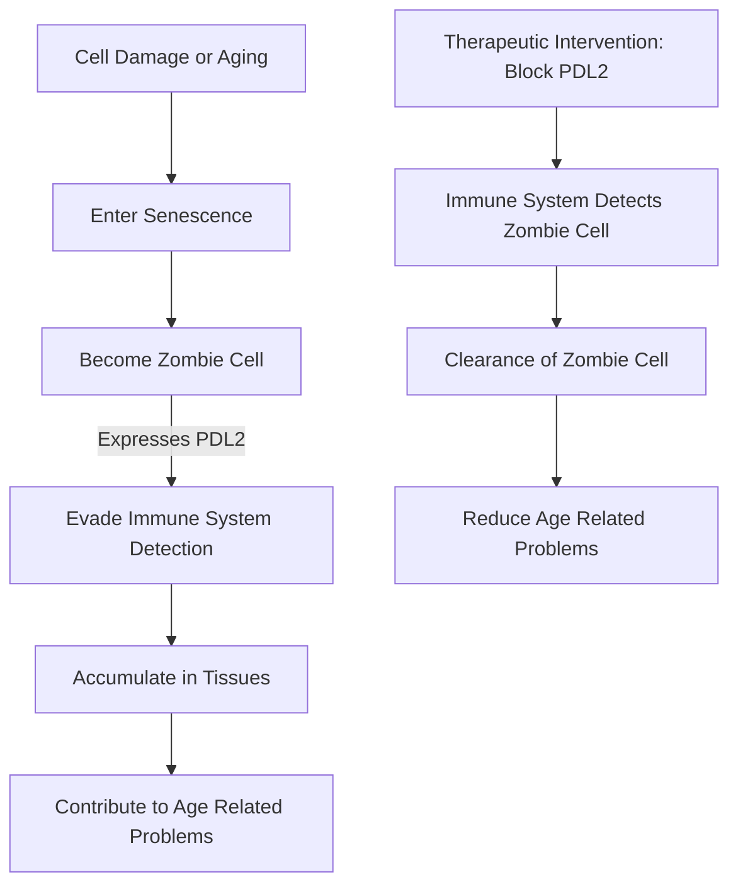

**Unmasking Immortality: Scientists Discover How "Zombie Cells" Evade Detection**

October 17, 2026

In a significant breakthrough for anti-aging research, scientists have recently uncovered a key mechanism by which harmful "zombie cells," or senescent cells, manage to evade the body's immune system. This discovery, announced on October 14, 2026, sheds new light on the cellular processes that contribute to age-related diseases and opens promising avenues for future therapies.

Senescent cells are damaged cells that stop dividing but remain alive, accumulating in tissues over time. They are known to release substances that trigger inflammation and disrupt the normal function of surrounding healthy cells, contributing to a range of age-related health problems. Until now, precisely how these persistent cells escape the body's natural clearance mechanisms remained a mystery.

Researchers have identified a protein, PD-L2, that acts as a cloak for these senescent cells, allowing them to hide from immune detection. In studies conducted on mice, blocking this protein led to a reduction in "zombie cells" and associated inflammation, along with improvements in blood sugar regulation and physical strength. The findings suggest that targeting PD-L2 could offer a novel strategy for developing therapies to combat the detrimental effects of aging. Furthermore, the protein could potentially serve as a blood marker for detecting and monitoring these harmful cells in humans. This revelation moves us closer to understanding and potentially manipulating the aging process at a cellular level.

