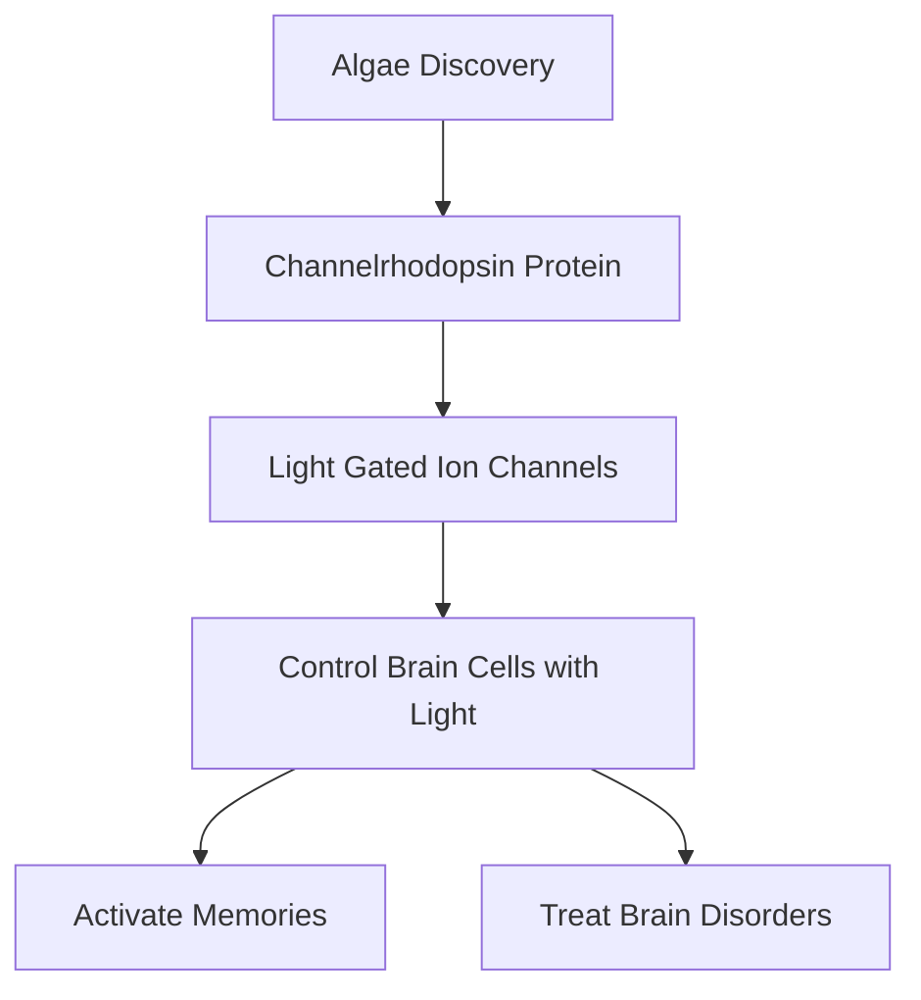

## Light-Activated Minds: 2026 Nobel Laureates Unveil Optogenetics Revolution

**October 19, 2026** – Today marks a pivotal moment in neuroscience, as the 2026 Nobel Prize in Physiology or Medicine has been jointly awarded to Karl Deisseroth, Peter Hegemann, and Georg Nagel. Their groundbreaking discoveries concerning light-gated ion channels have paved the way for optogenetics, a revolutionary technique that allows scientists to control brain cells with light.

The journey began with the humble, single-celled alga *Chlamydomonas*. Peter Hegemann and Georg Nagel uncovered a remarkable protein within this alga called channelrhodopsin, which acts as a light-sensitive switch. Building on this, Karl Deisseroth ingeniously transformed this protein into a tool to precisely control nerve cells. This breakthrough means researchers can now switch specific brain cells on and off using pulses of light, offering unprecedented control and insight into the brain's complex circuitry.

The impact of optogenetics is already profound. It has enabled researchers to activate memories in living brains and is opening new avenues for restoring vision and developing treatments for a range of brain disorders. This elegant method provides a level of precision previously unimaginable, allowing scientists to pinpoint the causal relationships between neural activity and behavior.

The laureates' work has laid the foundation for a new era in neuroscience, promising deeper understandings of the brain and novel therapeutic strategies for neurological and psychiatric conditions.

