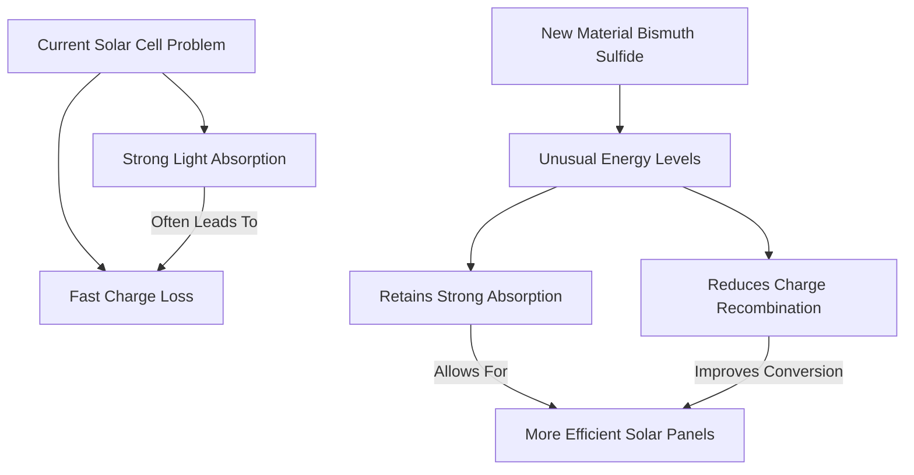

## Solar Breakthrough: New Material Promises More Efficient Energy Capture

**October 28, 2026** – A significant hurdle in solar energy efficiency may have been overcome, thanks to new research from the University of Oxford. Scientists have identified a novel semiconductor, bismuth sulfide, that defies a long-standing trade-off in light-harvesting materials, paving the way for solar panels with higher outputs.

For years, a fundamental challenge in solar cell technology has been that materials which absorb sunlight most strongly also tend to lose their electrical charges (electrons and holes) more quickly. This rapid recombination of charges wastes the captured energy, limiting overall efficiency.

The Oxford team's discovery reveals that bismuth sulfide exhibits an unusual arrangement of energy levels. This unique electronic structure allows the material to strongly absorb light while simultaneously slowing down the rate at which electrical charges are lost. By sidestepping this inherent trade-off, bismuth sulfide offers a new principle for designing semiconductors that can convert more captured light into usable electricity. This breakthrough could lead to the development of more efficient solar panels, boosting the potential for renewable energy generation.

