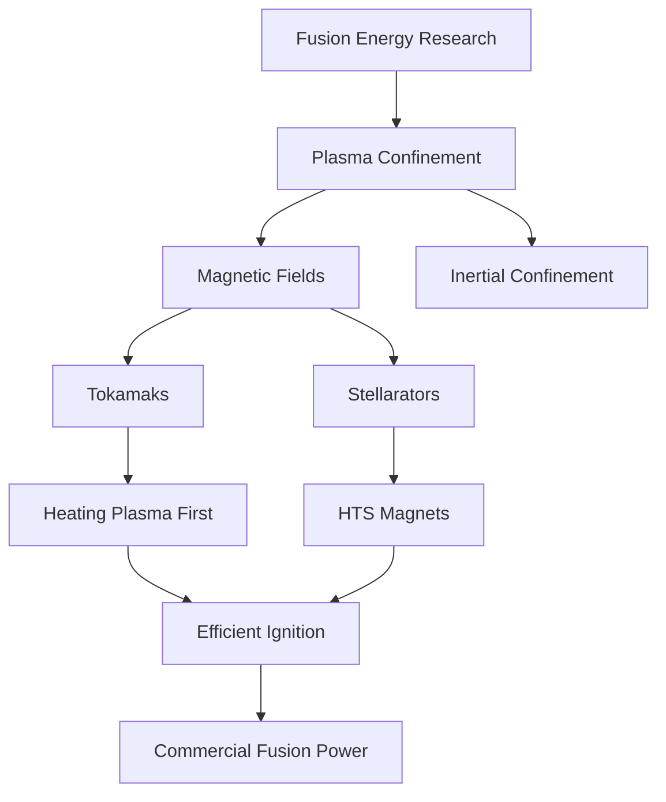

## Science Unveiled: October 31, 2026's Cutting-Edge Discoveries

As October 2026 draws to a close, the world of science is buzzing with breakthroughs that promise to redefine our future. From the astounding leaps in artificial intelligence to significant strides in clean energy and cosmic revelations, this month has delivered a cascade of monumental news.

Artificial Intelligence continues its breathtaking ascent. October has been an "insane month for AI," with OpenAI surprising mathematicians by generating 722 AI-powered math papers. Anthropic's Claude achieved major quantum computing breakthroughs, while Google's Gemini 4 Argon demonstrated incredible autonomous capabilities, rewriting code and improving quantum computing. Across the board, AI is advancing rapidly in areas like multimodal reasoning, context window expansion, and inference efficiency, leading to broader enterprise adoption for tasks such as customer service automation and code generation.

The quest for limitless clean energy is also accelerating. General Fusion announced a world-first, reaching electron temperatures above 1 keV on its LM26 Magnetized Target Fusion machine. Meanwhile, Commonwealth Fusion Systems is set to lead an AI-enabled digital twin project for its SPARC prototype fusion machine, a collaboration involving Google DeepMind and NVIDIA. In a potentially game-changing development, scientists at Princeton Plasma Physics Laboratory have identified a more efficient route to fusion ignition by reversing the traditional approach, opting to heat plasma *before* increasing its density. This could substantially reduce the energy required for a self-sustaining fusion reaction.

In space, the NSF-DOE Vera C. Rubin Observatory has made headlines with the discovery of 2026 ED138, a new dwarf planet candidate orbiting beyond Pluto, potentially one of the largest ever found in that region. Meanwhile, samples from the asteroid Bennu are continuing to unveil surprising details about the early formation of our Solar System, suggesting a crucial role for Jupiter. Further out, astronomers have detected three actively feeding black holes within a single galaxy more than 12.5 billion light-years away, offering a rare glimpse into the universe's infancy.

This October underscores humanity's relentless pursuit of knowledge, pushing the boundaries of what's possible and laying the groundwork for a future shaped by remarkable scientific innovation.

