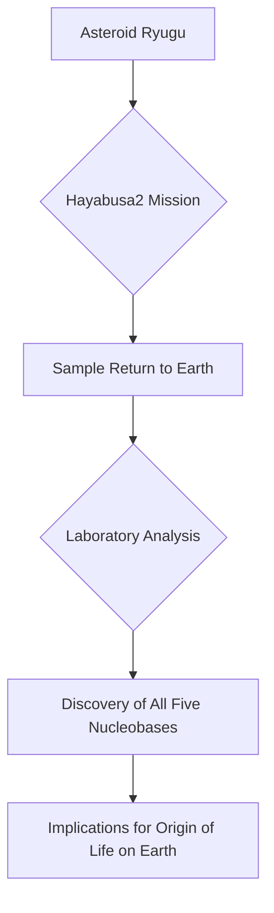

## Science Unlocks Cosmic Secrets: Life's Building Blocks Found in Asteroid Samples

**November 03, 2026** – Today marks another exciting day in the world of science, with groundbreaking discoveries pushing the boundaries of our understanding, from the very origins of life to the vastness of our solar system.

In a monumental finding reported today, scientists have announced the discovery of all five essential nucleobases—the fundamental "letters" of DNA and RNA—within pristine samples collected from the asteroid Ryugu. This remarkable revelation suggests that key ingredients necessary for life were prevalent in space billions of years ago, strengthening the hypothesis that cosmic events contributed to life's genesis on Earth. The samples, returned to Earth in 2020 by the Japan Aerospace Exploration Agency's (JAXA) Hayabusa2 mission, offer an unprecedented glimpse into the chemical makeup of the early Solar System. Researchers meticulously analyzed the asteroid material in ultra-clean lab conditions to confirm the presence of these crucial organic molecules.

Beyond the microscopic, our solar system continues to reveal its secrets. Europe's Hera spacecraft is currently making its approach to the Didymos-Dimorphos asteroid system, capturing its first clear views of the celestial pair. This mission aims to thoroughly investigate the aftermath of NASA's historic DART impact in 2022, when a spacecraft deliberately collided with Dimorphos to alter its orbit as a planetary defense test. Scientists are eager to understand why the asteroid's orbital change was significantly greater than predicted, probing its physical properties and internal structure.

The universe also continues to surprise us with its enigmatic phenomena. Just yesterday, scientists announced a potential "loophole" in the laws governing black holes, suggesting that extremely fast-spinning black holes might have the capacity to split in two. This theoretical finding opens the door to an entirely new class of black hole phenomena that could potentially be observed by future telescopes.

These recent advancements underscore the relentless pursuit of knowledge that characterizes scientific endeavor, continually reshaping our understanding of life, our cosmic neighborhood, and the fundamental laws of the universe.

