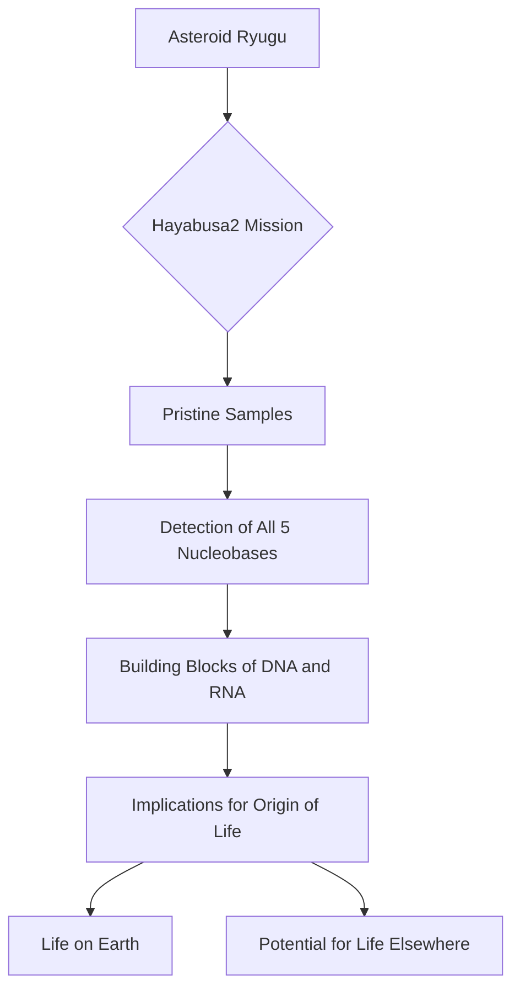

## Cosmic Building Blocks: All Five DNA/RNA Bases Found on Asteroid Ryugu

**November 7, 2026** – In a discovery that deepens our understanding of life's origins, scientists have confirmed the presence of all five essential nucleobases — the fundamental "letters" of DNA and RNA — within pristine samples returned from the asteroid Ryugu. This remarkable finding adds to the growing evidence that the key ingredients for life were widespread throughout the early Solar System.

The samples, collected by the Japan Aerospace Exploration Agency's (JAXA) Hayabusa2 mission in 2020, offer an unparalleled glimpse into the chemical composition of primitive asteroids, free from Earthly contamination. Previous analysis had identified uracil, one of the nucleobases, but a new study published in *Nature Astronomy* confirms the presence of adenine, guanine, cytosine, thymine, and uracil in these extraterrestrial materials.

Nucleobases are nitrogen-containing organic molecules that combine with sugars and phosphates to form nucleotides, which are the building blocks of genetic material. Without these molecules, the genetic code that enables organisms to grow, reproduce, and evolve would not exist. The discovery on Ryugu suggests that these crucial components for life may have been readily available in space billions of years ago. This strengthens the hypothesis that asteroids could have delivered these vital ingredients to early Earth, making the genesis of life a truly cosmic chemical story.

