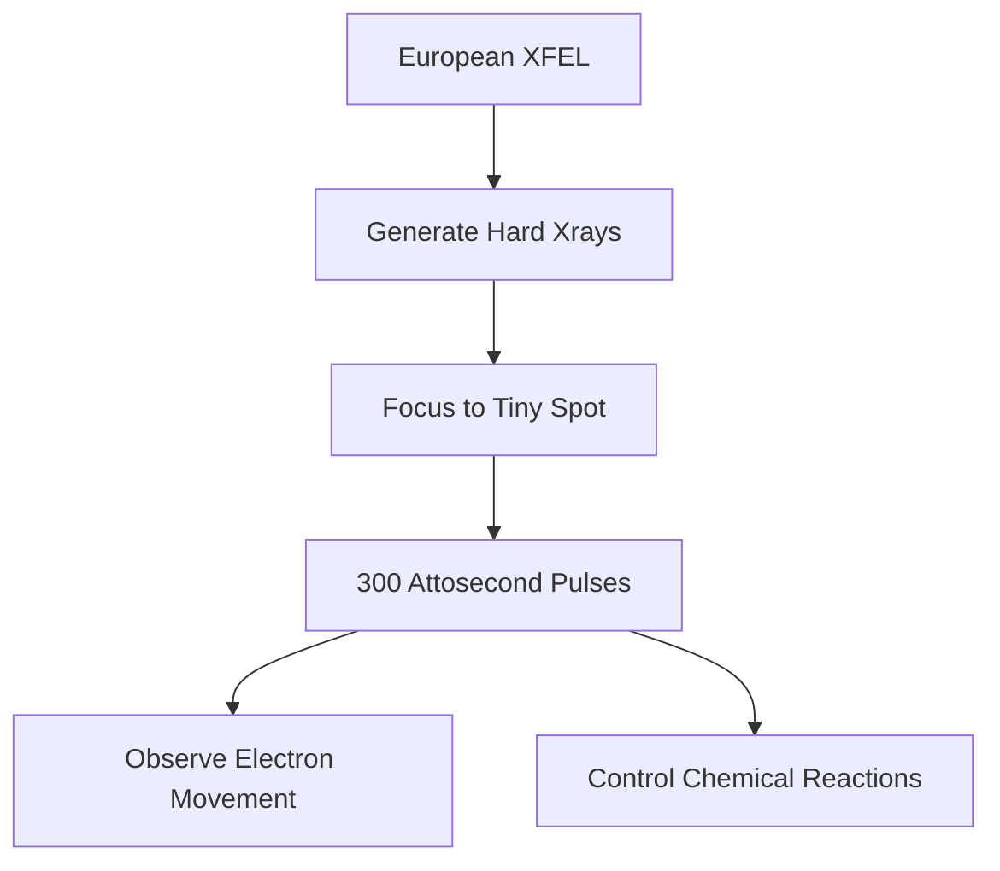

## Science Update: Peering into the Quantum Realm and Reprogramming for Health

As of November 8, 2026, the world of science continues to push boundaries, revealing insights from the farthest reaches of space to the most intricate processes within our bodies. Recent breakthroughs promise to revolutionize fields from fundamental chemistry to cancer therapy.

One of the most remarkable recent achievements comes from the European XFEL, where scientists have generated record-breaking X-ray flashes lasting an astonishing 300 attoseconds. These incredibly brief and intense pulses, concentrated into a spot 100,000 times smaller than a human hair, open up unprecedented opportunities. This innovation could allow researchers to directly observe the rapid movements of electrons during chemical reactions and potentially even learn to control these ultrafast processes. The ability to witness these fundamental interactions in real-time could unlock new avenues in materials science, drug discovery, and energy research.

Meanwhile, in a significant stride for medical science, MIT researchers have developed nanoparticles capable of reprogramming immune cells directly inside the body. In mouse experiments, this innovative approach has been shown to effectively attack cancer cells and reverse liver damage. This breakthrough suggests a future where our own immune systems can be more precisely directed to combat diseases, offering a potent new strategy against challenging conditions like cancer.

Beyond Earth, humanity's enduring journey into the cosmos reached another historic milestone this month. NASA's venerable Voyager 1 spacecraft achieved the extraordinary distance of one light-day from Earth, becoming the first human-made object to travel so far from our planet. This means a radio signal sent from Earth now takes a full 24 hours to reach Voyager 1.

The pace of discovery remains relentless, with each new finding building on the last, shaping our understanding of the universe and our place within it.

