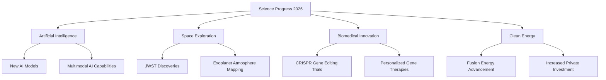

**Science Unveiled: November 2026's Cutting-Edge Discoveries**

As November 2026 unfolds, the world of science continues its breathtaking pace of discovery, delivering breakthroughs that promise to reshape our understanding of the universe and improve human lives. From advanced artificial intelligence to cosmic revelations and medical marvels, here's a snapshot of the most compelling live news in science.

**AI's Relentless March Forward**
This month alone has seen a flurry of activity in artificial intelligence. Major developers have released a cascade of new models, including Google's Gemini 4 Carbon, Anthropic's Claude Fable 5.2, and new offerings from OpenAI's GPT-6 family. These advanced systems are pushing boundaries with enhanced multimodal reasoning capabilities, real-time data processing, and highly specialized applications. Recent breakthroughs include expanded context windows that enable AI to analyze entire legal documents or scientific papers in a single pass, alongside the emergence of "personal agents" designed to automate individual workflows. The integration of AI into robotics and industrial automation is also gaining significant traction, with expectations that a substantial portion of new industrial robots will soon leverage open Physical AI frameworks.

**Webb's Cosmic Revelations from the Deep Field**
The James Webb Space Telescope (JWST) continues to astound, providing unprecedented insights into distant exoplanets. Just last month, astronomers revealed that the scorching gas giant WASP-17b, located 1,300 light-years away, possesses a surprisingly lopsided atmosphere with a distinct bulge. This asymmetry, caused by powerful winds, was uncovered using a groundbreaking new "transmission strings" mapping technique. Adding to its observational prowess, scientists have developed a revolutionary imaging technique that uses a digital twin of the JWST to effectively remove stellar glare, making faint exoplanets significantly easier to detect. This method has already uncovered a previously hidden planet in existing telescope data. Furthermore, Webb has re-confirmed the unexpected presence of a dense, highly reflective atmosphere, complete with clouds or haze, on the super-Earth lava planet TOI-561 b.

**Biotech and Energy Horizons Expanding**
In biomedical innovation, CRISPR gene editing continues its clinical progression. CRISPR Therapeutics recently presented promising Phase 1b clinical data on November 9, 2026, for CTX310, an investigational in vivo CRISPR/Cas9 therapy. This therapy demonstrated significant reductions in a key protein and triglycerides in patients suffering from severe hypertriglyceridemia. This progress builds on the FDA's new "plausible mechanism framework," introduced in February 2026, which streamlines the regulatory pathway for individualized genomic therapies and is a transformative development for CRISPR applications.

Meanwhile, the quest for clean energy saw significant developments with the release of the IAEA World Fusion Outlook 2026. The report highlights that fusion energy is now in a "crucial transitional phase," attracting a record $4.5 billion in private funding over the last year. The challenge ahead lies in integrating science, engineering, investment, and regulation to move from experimental research to commercially viable energy.

***

