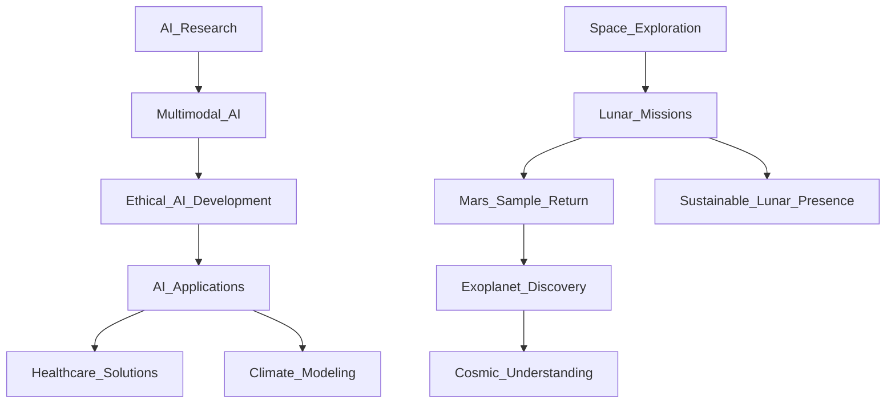

Today's Date: November 14, 2026

## Science in Motion: A Glimpse at Today's Frontiers

The world of science never stands still, and as we navigate mid-November 2026, the pace of discovery continues to accelerate across multiple disciplines. While specific breaking news evolves hourly, several major thrusts consistently capture headlines and push the boundaries of human knowledge.

One of the most dynamic fields remains Artificial Intelligence. Researchers worldwide are reporting significant strides in developing more robust and adaptable general-purpose AI systems. The focus is increasingly on multimodal AI, capable of seamlessly processing and integrating information from diverse sources like text, images, and video to understand complex contexts. This has profound implications for everything from personalized medicine, assisting doctors in diagnostics, to sophisticated climate modeling, offering deeper insights into environmental challenges. Ethical AI development and ensuring transparent decision-making processes remain central to these advancements, guiding the deployment of increasingly powerful intelligent systems.

Meanwhile, humanity's reach continues to extend into the cosmos. Space exploration remains a hotbed of activity, with ongoing missions and ambitious future plans dominating discussions. The Artemis program is steadily progressing towards establishing a sustainable human presence on the Moon, with crucial infrastructure development and scientific experiments underway. Furthermore, the meticulous planning for Mars sample return missions is advancing, aiming to bring invaluable Martian rock and soil samples back to Earth for unprecedented laboratory analysis, potentially revealing secrets about the Red Planet's past and the possibility of extraterrestrial life. Beyond our solar system, next-generation telescopes continue to refine their observations, leading to exciting new discoveries of exoplanets and a deeper understanding of star formation and galactic evolution.

These ongoing endeavors underscore a vibrant scientific landscape, where relentless curiosity drives continuous progress and promises to reshape our understanding of ourselves and the universe around us.

