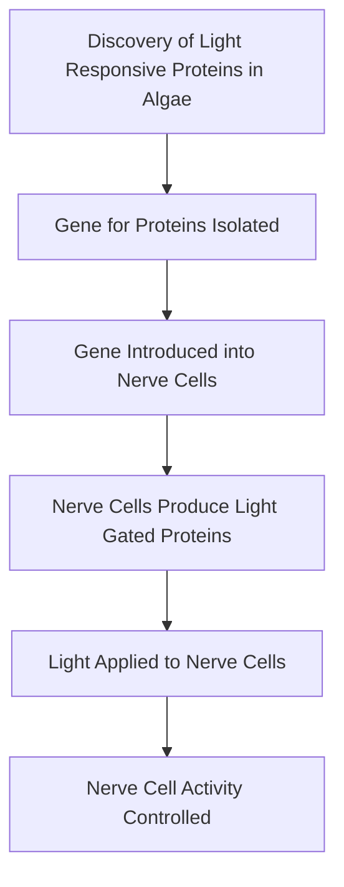

## Science Spotlight: Illuminating the Brain with Optogenetics – A Nobel-Winning Breakthrough

Today, November 15, 2026, the scientific community is buzzing with excitement over a groundbreaking achievement recognized by the Nobel Prize in Physiology or Medicine. Karl Deisseroth, Peter Hegemann, and Georg Nagel were honored for their pioneering work in optogenetics, a revolutionary technique that allows scientists to control brain cells using light.

This innovative method has transformed neuroscience, offering an unprecedented ability to switch specific nerve cells on and off, much like flipping a light switch. The journey began with the discovery of special light-responsive proteins in algae. Scientists then learned how to introduce the genetic instructions for these proteins into targeted nerve cells. Once incorporated, these modified cells produce the light-gated proteins, making them responsive to external light. By directing precise beams of light, researchers can then activate or silence these cells, providing a powerful tool to investigate their roles in various brain functions and disorders.

The implications of optogenetics are vast. It enables researchers to study complex neurological conditions such as Parkinson's disease, depression, and epilepsy by pinpointing the specific brain circuits involved. While primarily a research tool today, it holds immense promise for developing more precise and targeted treatments for brain disorders in the future, and has even shown potential for activating memories and restoring vision.

The elegance of optogenetics lies in its ability to precisely manipulate neuronal activity, offering profound insights into the intricate workings of the brain.

