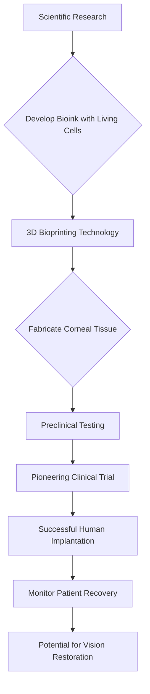

## Visionary Breakthrough: 3D Bioprinting Restores Sight in Pioneering Trial

**November 18, 2026** – Science continues to push the boundaries of what's possible, and today, we're looking at a remarkable development in regenerative medicine that offers new hope for restoring vision. In a groundbreaking clinical trial, surgeons have successfully implanted the world's first 3D-bioprinted human corneal tissue into a patient. This pivotal moment could revolutionize the treatment of corneal damage and disease, moving us closer to a future where replacement tissues are readily available.

For decades, organ and tissue shortages have presented significant challenges in healthcare. The advent of 3D bioprinting, a technology that uses "bioink" laden with living cells to construct biological tissues layer-by-layer, promises to overcome these limitations. While still in its infancy, with roots in the 1980s, the field has seen rapid advancements.

This year marks a significant leap, with the successful implantation of bioprinted corneal tissue. The cornea, the transparent outer layer of the eye, is vital for clear vision. Damage or disease to this tissue can lead to severe visual impairment or blindness. This clinical trial showcases the growing potential of bioprinting to create complex, functional human tissues. The results of this ambitious trial, which involved corneal endothelial cells to form the implant, are eagerly anticipated and set to be revealed in the second half of 2026.

This advancement not only offers hope for countless individuals awaiting corneal transplants but also highlights the broader implications of bioprinting for other tissues and organs, from skin and bladders to blood vessels. As researchers refine techniques and improve the accuracy of bioink deposition, the vision of customized, on-demand replacement organs draws closer to reality.

