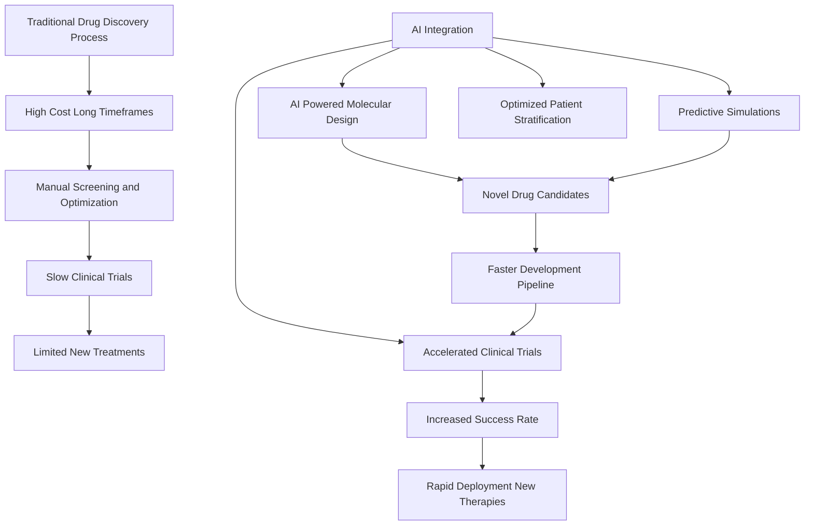

## AI Revolutionizes Drug Discovery: A New Era for Medicine Unfolds

As of November 24, 2026, the scientific community is buzzing with the transformative power of Artificial Intelligence in accelerating drug discovery. What once took a decade or more is now being compressed into a fraction of that time, promising a new era of faster and more effective treatments for countless diseases.

Recent advancements in AI, particularly in generative AI and machine learning, are fundamentally reshaping how new medicines are conceptualized, developed, and brought to market. Generative AI models are now capable of designing novel molecules with precision, specifically engineered to target previously "undruggable" proteins. This shift from a trial-and-error approach to a more deterministic, multi-objective molecular design is a paradigm shift.

AI's impact extends beyond initial design. Sophisticated predictive modeling allows researchers to simulate molecular behavior with near-atomic precision, drastically reducing the need for extensive physical experimentation. Furthermore, AI is optimizing clinical trial designs by refining inclusion criteria, dosing regimens, and endpoint selection, leading to higher success rates in early clinical trials. A 2024 industry analysis noted that AI-assisted drug candidates achieved Phase I success rates nearing 90 percent, a significant leap from traditional averages of 40-65 percent.

This integration of AI is not just about speed; it's about precision. AI algorithms can identify subtle genetic or molecular signals for patient stratification, ensuring that the right drug reaches the right person at the right dose. Companies like Insilico Medicine have already seen AI-discovered fibrosis candidates advance to human trials in under 18 months, a process that typically takes around four years. As AI continues to evolve, its role as a "thought partner" for scientists, challenging interpretations and connecting interdisciplinary ideas, will only deepen.

The implications are profound, offering hope for rapid development of therapies for complex and rare diseases, ultimately leading to improved patient outcomes globally.

